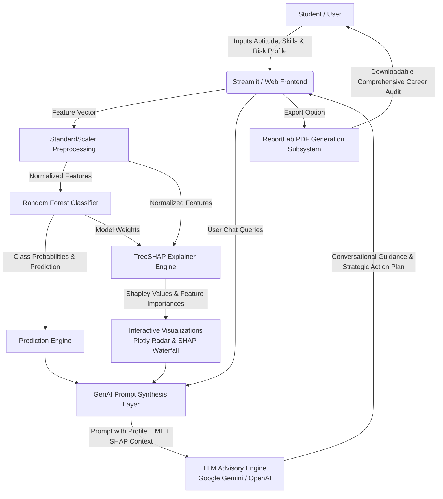

# 🧭 CLARITY: An Explainable and Generative AI Framework for Intelligent Career Decision Advisory

[](https://www.python.org/)
[](https://streamlit.io/)
[](https://scikit-learn.org/)
[](https://shap.readthedocs.io/)
[](https://ai.google.dev/)
[](LICENSE)

---

## 📌 Table of Contents
- [Project Overview](#-project-overview)
- [The Problem: The "Black Box" of Career AI](#-the-problem-the-black-box-of-career-ai)
- [The CLARITY Solution](#-the-clarity-solution)
- [System Architecture](#-system-architecture)
- [Key Features](#-key-features)
- [Tech Stack](#-tech-stack)
- [Project Structure](#-project-structure)
- [Installation & Quick Start](#-installation--quick-start)
- [Machine Learning & XAI Methodology](#-machine-learning--xai-methodology)
- [Academic Report & Viva Guide](#-academic-report--viva-guide)
- [Ethical Considerations](#-ethical-considerations)
- [Contributing & License](#-contributing--license)

---

## 📖 Project Overview

**CLARITY** (**C**areer & **L**ife **A**dvisory through **R**easoned **I**nterpretable **T**ransparent A**I**) is an intelligent, multi-layered decision-support platform designed to help students, graduates, and early-career professionals make informed, high-stakes career decisions (e.g., **Corporate Job**, **Higher Studies**, or **Startup / Entrepreneurship**).

Unlike traditional black-box recommendation systems, CLARITY pairs a **Random Forest Classifier** with **TreeSHAP (SHapley Additive exPlanations)** to explain *why* a specific pathway is recommended, and integrates a **Generative AI Mentor (Google Gemini / OpenAI)** to translate complex data into empathetic, actionable, and personalized career roadmaps.

---

## ⚠️ The Problem: The "Black Box" of Career AI

Most existing AI career recommendation systems present users with a singular output (e.g., *"You should pursue a Corporate Job (85% match)"*) with zero explanation of how that conclusion was derived. 

In high-stakes life decisions:
1. **Lack of Trust**: Students reject automated advice when reasons are opaque.
2. **Hidden Biases**: Biased training sets can silently penalize specific demographics or mindsets.
3. **No Actionable Guidance**: A percentage score does not tell an individual what skills to improve or how to overcome financial or risk barriers.

---

## 💡 The CLARITY Solution

CLARITY solves this by unifying three complementary pillars:

```
+-------------------------------------------------------------------------------+
|                                    CLARITY                                    |
|                                                                               |
|   [ 1. Predictive Engine ]  -->  [ 2. Explainable AI ]  -->  [ 3. GenAI ]     |
|   Random Forest Model            TreeSHAP Feature            Google Gemini    |
|   Calculates Probabilities       Attribution (No Black Box)  Contextual Advice|
+-------------------------------------------------------------------------------+
```

1. **Predictive Machine Learning**: Accurately classifies optimal career trajectories based on multidimensional aptitude, risk, financial, and psychological metrics.
2. **Explainable AI (XAI)**: Deconstructs the decision using game theory (Shapley values) to show the exact positive and negative drivers behind the recommendation.
3. **Generative AI Advisory**: Ingests user attributes, ML probabilities, and top SHAP drivers into a customized LLM prompt to conduct interactive, human-like mentoring sessions and generate downloadable PDF reports.

---

## 🏗️ System Architecture



---

## ✨ Key Features

- **🎯 Step 1: Psychometric & Aptitude Profiling**: Evaluates technical prowess, communication, risk tolerance, financial stability, academic interests, and entrepreneurial mindset.
- **📊 Step 2: Transparent XAI Dashboard**:
  - Probability distribution across *Corporate Job*, *Higher Studies*, and *Startup*.
  - Multidimensional Radar charts displaying holistic student aptitude.
  - Interactive SHAP waterfall and bar plots breaking down individual feature contributions.
- **💬 Step 3: Interactive GenAI Mentor**:
  - Conversational assistant powered by Google Gemini.
  - Pre-conditioned with the user's ML predictions and SHAP explainability insights.
  - Dynamic follow-ups on risk mitigation, bridge skills, and study avenues.
- **📄 Automated PDF Reports**: Generates formal, downloadable audit reports summarizing profile data, ML recommendations, and full consultation transcripts.
- **🌐 Dual Frontend Flexibility**:
  - **Full Experience**: Rich Streamlit application with full XAI and Gemini LLM chat.
  - **Lightweight Alternative**: Standalone Flask + Tailwind CSS interface with real-time sliders and career roadmap knowledge base.

---

## 🛠️ Tech Stack

| Layer | Technology | Purpose |
|---|---|---|
| **Primary Frontend** | [Streamlit](https://streamlit.io/) | Reactive dashboard, XAI plots, and chat interface |
| **Secondary Frontend** | [Flask](https://flask.palletsprojects.com/) + Tailwind CSS | Alternative lightweight web UI |
| **Machine Learning** | [Scikit-Learn](https://scikit-learn.org/) | Random Forest Classifier, StandardScaler, Pipeline |
| **Explainable AI** | [SHAP](https://shap.readthedocs.io/) | TreeSHAP explainer for local & global interpretability |
| **Generative AI** | [Google Generative AI](https://ai.google.dev/) (Gemini API) | Empathetic, conversational career advisor |
| **Data Processing** | [Pandas](https://pandas.pydata.org/), [NumPy](https://numpy.org/) | Tabular data manipulation and mathematical ops |
| **Visualizations** | [Plotly](https://plotly.com/), [Matplotlib](https://matplotlib.org/) | Radar charts, feature importance bar charts |
| **Document Generation** | [ReportLab](https://www.reportlab.com/) | Automated PDF report compilation |

---

## 📂 Project Structure

```bash
CLARITY-An-Explainable-and-Generative-AI-Framework/
│
├── data/
│   └── student_career_data.csv    # Synthetic dataset for model training
├── models/
│   ├── career_model.pkl           # Pre-trained Random Forest Classifier
│   └── scaler.pkl                 # Pre-fitted StandardScaler
├── templates/
│   └── index.html                 # Tailwind CSS frontend for Flask app
│
├── Main App.py                    # Primary Streamlit app (ML + XAI + Gemini LLM)
├── app.py                         # Alternative Flask application
├── Data Generator.py              # Synthetic data generator script
├── Model Trainer.py               # Model training and evaluation script
│
├── career_dataset.csv             # Reference skill-to-career dataset
├── Project Documentation.txt      # Project report outline and viva notes
├── requirements.txt               # Complete Python dependencies
├── .env.example                   # Environment variable template
├── .gitignore                     # Git ignore rules
└── README.md                      # Comprehensive project documentation
```

---

## 🚀 Installation & Quick Start

### 1. Prerequisites
- Python 3.9, 3.10, or 3.11 installed.
- Git installed.
- (Optional) A Google Gemini API key ([Get one free here](https://aistudio.google.com/)).

### 2. Clone the Repository
```bash
git clone https://github.com/AnujKaiprath04/CLARITY-An-Explainable-and-Generative-AI-Framework-for-Intelligent-Career-Decision-Advisory.git
cd CLARITY-An-Explainable-and-Generative-AI-Framework-for-Intelligent-Career-Decision-Advisory
```

### 3. Create a Virtual Environment
```bash
# Windows
python -m venv venv
venv\Scripts\activate

# macOS / Linux
python3 -m venv venv
source venv/bin/activate
```

### 4. Install Dependencies
```bash
pip install -r requirements.txt
```

### 5. Configure API Key
Copy `.env.example` to `.env` and add your Google Gemini API key:
```bash
cp .env.example .env
```
Inside `.env`:
```env
GEMINI_API_KEY=your_gemini_api_key_here
```
*(Note: You can also enter the API key directly within the Streamlit UI).*

### 6. (Optional) Re-generate Dataset & Re-train Model
If you wish to re-train the models from scratch:
```bash
python "Data Generator.py"
python "Model Trainer.py"
```

### 7. Run the Application
Launch the flagship Streamlit application:
```bash
streamlit run "Main App.py"
```
Or launch the alternative Flask application:
```bash
python app.py
```

---

## 🔬 Machine Learning & XAI Methodology

### 1. Machine Learning Pipeline
- **Algorithm**: `RandomForestClassifier(n_estimators=100, max_depth=10, random_state=42)`
- **Preprocessing**: `StandardScaler` to normalize student aptitude features.
- **Classes**:
  - `0`: **Corporate Job**
  - `1`: **Higher Studies**
  - `2`: **Startup / Entrepreneurship**

### 2. Explainable AI via TreeSHAP
SHAP calculates the Shapley value $\phi_i$ of each feature $i$, representing its marginal contribution across all feature subsets:

$$\phi_i(v) = \sum_{S \subseteq N \setminus \{i\}} \frac{|S|!(|N| - |S| - 1)!}{|N|!} (v(S \cup \{i\}) - v(S))$$

In CLARITY:
- **Positive SHAP Values**: Characteristics that pushed the recommendation towards the selected career.
- **Negative SHAP Values**: Characteristics that worked against or lowered confidence in the selected career.
- **TreeSHAP Optimization**: Computes exact Shapley values in polynomial time rather than exponential sampling, ensuring real-time UI interactivity.

---

## 🎓 Academic Report & Viva Guide

### Frequently Asked Viva Questions

**Q1: Why choose Random Forest over Deep Learning?**  
> *Answer*: Deep neural networks are computationally heavy and behave as opaque black boxes. Tabular student psychometric data performs exceptionally well with tree ensembles. Random Forest integrates natively with TreeSHAP to compute mathematically exact Shapley values in polynomial time, which directly satisfies the core requirement of Explainable AI.

**Q2: How does TreeSHAP overcome traditional black-box limitations?**  
> *Answer*: Rather than relying on simple global feature importances (which only show what matters on average across the entire dataset), TreeSHAP provides *local explanations*. It reveals the exact features and magnitudes that influenced an individual student's specific prediction.

**Q3: How does Generative AI integrate with the Machine Learning model?**  
> *Answer*: We utilize context-conditioned Prompt Engineering. The raw student metrics, predicted career class, confidence probabilities, and the top-ranked SHAP drivers are injected into the system context. The LLM translates these quantitative mathematical findings into an empathetic, plain-language action roadmap.

---

## 🛡️ Ethical Considerations & Safeguards

1. **Human-in-the-Loop Philosophy**: The platform is explicitly labeled as an *Advisory System*, not an automated gatekeeper. Students retain complete agency over their life choices.
2. **Mitigating Algorithmic Bias**: Training datasets include varied combinations of socioeconomic proxies (e.g., Financial Stability) to prevent socio-economic penalization.
3. **Data Privacy**: No personally identifiable information (PII) is stored or passed to third-party APIs beyond the numeric assessment vector.

---

## 📄 License

This project is licensed under the **MIT License** — see the [LICENSE](LICENSE) file for details.

---

**Developed with ❤️ by [Anuj Kaiprath](https://github.com/AnujKaiprath04)**
